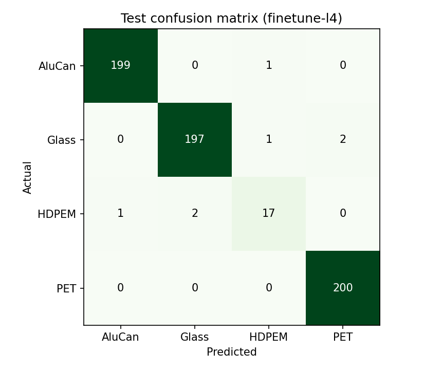
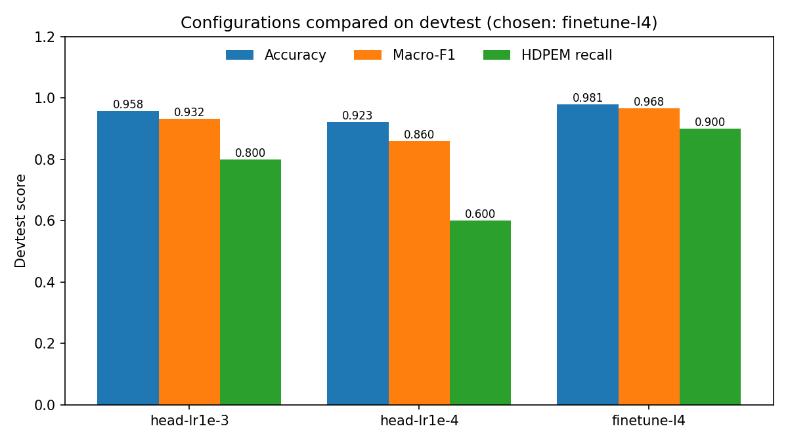
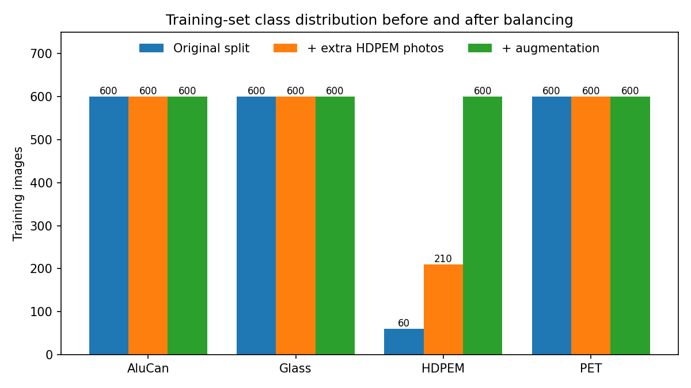

# Live Waste Sorter

[](https://github.com/jocelync07/waste-sorter/actions/workflows/ci.yml)

Point a webcam at a drink container and the app says what it is (**aluminium can, glass bottle, HDPE milk bottle or PET plastic bottle**) in real time, so it can go in the right recycling bin.

It takes an image classifier I built for a university computer-vision assignment and turns it into a deployed web app, with an API, tests, a Docker image, CI and a monitoring page.

<!-- Add a screenshot or GIF here: docs/demo.gif -->

## Results

The served model is ResNet18, pre-trained on ImageNet, with its **last residual block (layer4) fine-tuned** and a new final layer. It was chosen from three configurations on the devtest set, then scored once on a held-out test set of 620 images it never saw (seed 42, from [`models/metrics.json`](models/metrics.json)).

| Class | Recall | Precision |
|---|---|---|
| Aluminium can | 0.995 | 0.995 |
| Glass bottle | 0.985 | 0.990 |
| HDPE milk bottle | 0.850 | 0.895 |
| PET plastic bottle | 1.000 | 0.990 |
| **Overall** | **Accuracy 0.989** | **Macro-F1 0.962** |



HDPE is still the weakest class: 17 of its 20 test images are right, and 3 are taken for glass or an aluminium can. With only 20 HDPE test images, each mistake moves its recall by 5 points.

### Choosing the training setup

Three configurations were trained on the same split and compared on **devtest** only. The best was chosen by macro-F1, which weighs the rare HDPE class as much as the others; the test set was not used to choose.

| Configuration | What is trained | Learning rate | Best epoch | Devtest accuracy | Devtest macro-F1 | Devtest HDPE recall |
|---|---|---|---|---|---|---|
| `head-lr1e-3` | final layer only | 1e-3 | 30 of 30 | 0.958 | 0.932 | 0.80 |
| `head-lr1e-4` | final layer only | 1e-4 | 30 of 30 | 0.923 | 0.860 | 0.60 |
| **`finetune-l4`** | **layer4 + final layer** | **1e-4 (layer4), 1e-3 (final)** | **7 of 10** | **0.981** | **0.968** | **0.90** |



- **Learning rate:** with the backbone frozen, 1e-4 was too slow and was still improving at epoch 30. 1e-3 learned much faster and scored higher.
- **Fine-tuning:** also training layer4 gave the biggest gain, especially for HDPE (recall 0.80 → 0.90). A frozen ImageNet backbone was never taught what makes a matte white milk bottle different from glass or PET. Letting the last block adapt fixes much of that. Layer4 uses a 10× smaller learning rate than the new final layer, so the pre-trained weights change gently instead of being overwritten. Its BatchNorm statistics are kept from ImageNet, because the batches are small.

### Fixing the rare HDPE class

The dataset has 1,000 images each of cans, glass and PET, but only 100 of HDPE. Three steps were taken, and the devtest scores above show their combined effect:

1. **More real data:** 150 extra HDPE photos, added to the training set only (see [Data](#data)).
2. **Augmentation:** HDPE training images are augmented until every class has 600 (chart below).
3. **Fine-tuning layer4:** the largest single improvement in HDPE recall.



Augmentations, each copying a change that happens in real use:

| Transform | Why |
|---|---|
| Colour jitter (±20% brightness, contrast, saturation) | Different room lighting and camera white balance |
| Small rotation, shift and zoom | The bottle slightly tilted, off-centre, nearer or further away |
| Horizontal flip | A bottle has no meaningful left or right side |
| Vertical flip | In a bin or on a sorting belt, containers lie upside down as often as upright. The shape, cap and label cues stay the same |
| Light Gaussian blur | Webcam frames are softer than the dataset's product photos |

Next steps for HDPE, if more is needed: collect more real HDPE photos for devtest and test (20 is too few to measure well), and try a class-weighted loss without augmentation as another comparison.

## Data

- **Dataset:** [Drinking Waste Classification](https://www.kaggle.com/datasets/arkadiyhacks/drinking-waste-classification) (Kaggle), with the 3,100-image subset listed in `waste_dataset.csv` (1,000 AluCan, 1,000 Glass, 100 HDPEM, 1,000 PET).
- **Split:** 60/20/20 train/devtest/test, done separately for each class so every partition keeps the same class mix. It uses a fixed seed (42), so it is the same on every run. The exact split is saved in [`models/splits/`](models/splits/).
- **Extra HDPE photos:** 150 photos of HDPE milk bottles that I captured, named `new_HDPEM1.jpg` to `new_HDPEM150.jpg`. They were taken in bursts of 10 frames, 1 second apart. Between bursts the bottle, background, lighting, position, distance and orientation were changed, so the photos are not near-copies. Image sizes range from 384×512 to 1600×1200. They go into the **training set only**, so devtest and test stay comparable with the original dataset. The photos are not in this repository. Put them in `data/new_HDPEM/` and pass `--extra-hdpem data/new_HDPEM`.

## How it works

```
 Browser (webcam or upload)
        │  JPEG frame, once a second
        ▼
 FastAPI  POST /api/predict ──▶ preprocess (224×224, ImageNet normalisation)
        │                         ▼
        │                    ResNet18 (PyTorch, CPU) ──▶ class + probabilities
        │                         │
        ▼                         ▼
 GET /api/stats  ◀── prediction log (JSON lines: class, confidence, latency; no images)
        │
        ▼
 /monitor page: prediction counts, average confidence, low-confidence rate, latency
```

- **Model:** ResNet18 pre-trained on ImageNet, with layer4 fine-tuned and a new four-class final layer (see [Results](#results)).
- **Training:** `scripts/train.py` caches the output of the frozen layers (conv1 to layer3) once per image, so all three configurations train in about 5 minutes on a laptop CPU.
- **Serving:** FastAPI loads the model once at startup. Uploads are checked for size and type; unreadable files get a 400, not a crash.
- **Monitoring:** every prediction is logged (without the image) and summarised on `/monitor`, so you can spot when the model is often unsure.

| Endpoint | What it does |
|---|---|
| `GET /` | Webcam and upload page |
| `GET /monitor` | Monitoring page |
| `POST /api/predict` | Classify one image (multipart field `file`) |
| `GET /api/stats` | Prediction statistics |
| `GET /api/health` | Status and whether a trained model is loaded |
| `GET /docs` | Interactive API docs (Swagger) |

## Run it locally

Needs Python 3.9 or newer.

```bash
python -m venv .venv
.venv\Scripts\activate            # macOS/Linux: source .venv/bin/activate
pip install torch torchvision --index-url https://download.pytorch.org/whl/cpu
pip install -r requirements-dev.txt
```

### 1. Train the model

Download the dataset and `waste_dataset.csv`, then:

```bash
pip install -r requirements-train.txt
python scripts/train.py --data-root path/to/rawimgs --csv path/to/waste_dataset.csv --extra-hdpem data/new_HDPEM
```

This trains all three configurations and writes:

- `models/waste_resnet18.pth`: the chosen model (about 45 MB)
- `models/metrics.json`: devtest results for every configuration, and test results for the chosen one
- `models/splits/`: the exact train/devtest/test split
- `docs/*.png`: the charts in this README

Use `--configs finetune-l4` to train only one configuration, or `--charts-only` to redraw the charts from `metrics.json`.

### 2. Start the app

```bash
uvicorn app.main:app --reload
```

Open http://localhost:8000 and allow camera access. Browsers only allow the camera on `localhost` or HTTPS.

To work on the page without a trained model, start it with `ALLOW_UNTRAINED=1` (predictions are then random and the page says so).

### 3. Run the tests

```bash
pytest -v
```

The tests use random weights, so they need no dataset and run in CI.

## Docker

```bash
docker build -t waste-sorter .
docker run -p 8000:8000 waste-sorter
```

## Deploy

The image reads the `PORT` variable, so it runs on most container hosts. For example, on **Render**: create a *Web Service* from this GitHub repo, choose *Docker*, and deploy. On **AWS**, push the image to ECR and run it on App Runner.

## Project structure

```
app/
  main.py        FastAPI routes
  model.py       ResNet18, preprocessing, prediction
  monitor.py     prediction log and statistics
  config.py      settings from environment variables
  static/        webcam page and monitoring page
scripts/train.py split, configuration comparison, evaluation, charts and export
models/          trained model, metrics.json and the saved split
docs/            charts used in this README
tests/           pytest tests for the model, the API and the training helpers
.github/workflows/ci.yml   tests and Docker build on every push
```

## Limitations

- The model only knows four classes, so anything else (a hand, a cup, an empty desk) is still given one of them, sometimes with high confidence. A fifth "not a container" class, or rejecting low-confidence frames, would fix this.
- The training photos are mostly clean product shots, so busy backgrounds and poor light lower the confidence. The monitoring page shows this as a higher low-confidence rate.

## What I learned

- Taking a model from a notebook to a service: one shared preprocessing function for training and serving, loading the model once, and validating inputs.
- Choosing settings fairly: compare configurations on devtest, then touch the test set once. Fine-tuning one block did more for the rare class than any amount of training the final layer alone.
- Why monitoring matters: a lab test-set score does not show how the model does on a real webcam, but confidence and low-confidence rates do.
- Packaging with Docker and checking every change with CI.
